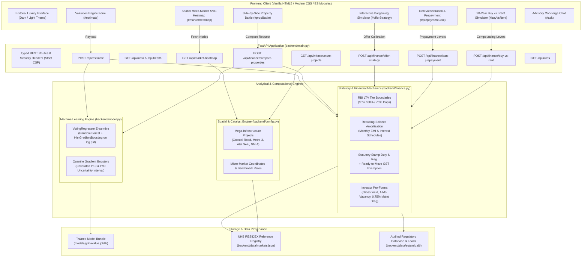

# EstateIQ · Residential Valuation Engine & Spatial Intelligence

[](https://www.python.org/downloads/)
[](https://fastapi.tiangolo.com/)
[](https://scikit-learn.org/)
[](https://opensource.org/licenses/MIT)
[]()

**EstateIQ** (formerly GrihaValue core valuation engine) is an architectural residential valuation and capital acquisition intelligence platform tailored for Indian prime micro-markets. It pairs machine learning valuation models with point-in-time statutory financial mechanics, spatial cluster intelligence, and wealth compounding simulators.

Built as an asynchronous **FastAPI** backend coupled with a zero-build, dependency-free **Vanilla ES Module** front end adhering to strict Content-Security-Policy rules.

---

## Architecture & System Workflow



---

## Key Modules & Features

### 1. Architectural Valuation Engine
* **Predictive Ensemble:** Voting regressor combining Random Forest and Histogram-based Gradient Boosting trained on log price-per-square-foot.
* **Calibrated Statistical Bounds:** P10 and P90 quantile gradient boosting models providing dynamic uncertainty spreads.
* **Statutory Acquisition Costing:** Calculates exact required upfront capital by enforcing:
  * Reserve Bank of India (RBI) Loan-to-Value (LTV) limits:
    * Up to ₹30 Lakhs: **90% LTV**
    * ₹30 Lakhs to ₹75 Lakhs: **80% LTV**
    * Above ₹75 Lakhs: **75% LTV**
  * State-specific stamp duty and registration fee schedules.
  * Goods and Services Tax (GST) rules (0% on Ready-to-Move vs. 5% on Under-Construction).

### 2. Institutional Investor Pro-Forma & Cash Flow
* **Real Net Rental Yield:** Dissects gross residential rental income by accounting for realistic holding frictions:
  * 1-month annual tenant turnover vacancy reserve.
  * 0.75% annual society maintenance and municipal taxation drag.
* **Tenant EMI Offset:** Computes the percentage of monthly debt service funded directly by tenant cash flow.
* **Equity Payback Period:** Years required to amortise statutory cash outlay through net rental yield.

### 3. Mega-Infrastructure Capital Appreciation Index
* Tracks active transformational transport infrastructure across the Mumbai Metropolitan Region (MMR):
  * **Mumbai Coastal Road (Dharmveer Swarajya Coastal Freeway):** BMC / MMRDA (+2.8% p.a. multiplier).
  * **Mumbai Metro Line 3 (Aqua Line Underground):** MMRC (+2.2% p.a. multiplier).
  * **Atal Bihari Vajpayee Sewri-Nhava Sheva Atal Setu (MTHL):** MMRDA (+3.4% p.a. multiplier).
  * **Navi Mumbai International Airport (NMIA):** CIDCO / Adani Airports (+3.6% p.a. multiplier).
* Generates compound 3-year and 5-year capital appreciation multipliers against NHB RESIDEX baselines.

### 4. Interactive Micro-Market Heatmap (Spatial Intelligence)
* Bespoke SVG vector cartography featuring geographic coordinate nodes across South Mumbai, Central Suburbs, Western Suburbs, and Navi Mumbai.
* Dynamic switching between **Capital Rate (₹/sq.ft.)** and **Gross Rental Yield (%)** heat spectrums.
* Direct one-click transfer of micro-market benchmark specifications into the Valuation Engine.

### 5. Side-by-Side Property Battle
* Institutional head-to-head decision matrix comparing up to 4 properties simultaneously.
* Evaluates total capital outlay, upfront statutory equity, monthly EMI, rental yields, and space-price efficiency scores.
* Dynamic category badges highlighting:
  * *Lowest Upfront Cash*
  * *Highest Rental Yield*
  * *Lowest Monthly Debt Service*
  * *Best Capital Value (₹/sq.ft.)*
* Algorithmic AI verdict ribbons (e.g. *Trophy Capital*, *Cash-Flow Champion*, *Value Alpha Pick*).

### 6. Interactive Offer Strategy & Bargaining Simulator
* Slide across the calibrated P10–P90 valuation band to assess seller negotiation friction.
* Models real-time savings in upfront stamp duty obligations and monthly EMI reduction.
* Generates copy-paste institutional talking points grounded in micro-market dispersion data.

### 7. Debt Acceleration & "Interest Saver" Calculator
* Simulates adding voluntary monthly top-ups and annual bonus lumpsum prepayments.
* Displays tenure reduction in years, total cumulative interest saved in ₹ Lakhs, and comparative repayment tracks (0% prepayment penalty under RBI floating-rate directives).

### 8. 20-Year "Buy vs. Rent" Wealth Compounding Comparison
* Mathematical simulation contrasting home equity appreciation against renting and compounding the upfront cash + monthly surplus in diversified equity index funds (Nifty 50 benchmark @ 10%–14% CAGR).
* Calculates exact portfolio crossover year (breakeven milestone).

---

## Quick Start & Installation

### Prerequisites
* Python 3.11 or newer
* Modern Web Browser (Chrome, Edge, Firefox, Safari)

### Setup Instructions

```bash
# 1. Clone the repository
git clone https://github.com/ayushbarve9/estateiq.git
cd estateiq

# 2. Create and activate a virtual environment
python -m venv .venv
source .venv/bin/activate       # On Windows: .venv\Scripts\activate

# 3. Install pinned dependencies
pip install -r requirements.txt

# 4. Run the test suite
python -m pytest backend/tests -q

# 5. Launch the application server with live reload
uvicorn backend.main:app --host 127.0.0.1 --port 8000 --reload
```

Open **[http://localhost:8000](http://localhost:8000)** in your browser.
API Swagger documentation is live at **[http://localhost:8000/docs](http://localhost:8000/docs)**.

---

## Training the Model

The shipped model bundle in `models/grihavalue.joblib` is trained and calibrated. To retrain:

```bash
# Retrain using benchmark generator
python -m backend.train

# Retrain using external transaction CSV
python -m backend.train --csv path/to/transactions.csv --out models/grihavalue.joblib
```

Required CSV schema: `City`, `Locality`, `BHK`, `Area_SqFt`, `Price_INR`, `Construction_Status`, `Property_Type`.

---

## API Reference Summary

| Method | Endpoint | Description |
|---|---|---|
| `GET` | `/api/health` | Service and model bundle readiness status |
| `GET` | `/api/meta` | Active cities, micro-markets, bounds, and provenance |
| `POST` | `/api/estimate` | Full property valuation and statutory cost breakdown |
| `GET` | `/api/market-heatmap` | Spatial micro-market nodes, rates, and yields |
| `POST` | `/api/finance/compare-properties` | Head-to-head 2 to 4 property comparison matrix |
| `POST` | `/api/finance/offer-strategy` | Bargaining band, discounts, and talking points |
| `POST` | `/api/finance/loan-prepayment` | Accelerated debt amortization simulation |
| `POST` | `/api/finance/buy-vs-rent` | 20-year wealth compounding simulation |
| `GET` | `/api/infrastructure-projects` | Active infrastructure catalysts for micro-markets |
| `GET` | `/api/rules` | Audited statutory regulatory citations |
| `POST` | `/api/contact` | Client dossier generation and valuation leads |
| `GET` | `/api/valuation/{ref_id}/certificate` | Download official certified valuation dossier PDF/print view |

---

## Testing & Quality Gates

Run the comprehensive pytest suite:

```bash
python -m pytest backend/tests -q
```

The test suite covers:
* Full reducing-balance amortisation to ₹0 balance.
* RBI LTV tier thresholds (₹30L, ₹75L).
* Stamp duty and GST regulatory rules.
* Offer strategy, loan prepayment, and buy-vs-rent math.
* Model bundle version compatibility, reproducibility, and holdout gates.
* API error handling (400 for business logic violations, 422 for schema errors).

---

## Security & Architectural Standards

* **Strict Content-Security-Policy (CSP):** `default-src 'self'`. Zero third-party scripts, CDNs, or inline script injections.
* **Zero Secrets in Browser:** Anthropic and database credentials are read on the server side only.
* **Deterministic Constants:** All financial constants reside exclusively in `backend/config.py` and carry verified source provenance.
* **Zero Framework Bloat:** Vanilla HTML5, modern CSS custom properties, and native ES modules with zero bundler overhead.

---

## About Me

### **Ayush Barve**
* **Role:** Machine Learning & Full-Stack Software Engineer
* **GitHub:** [@ayushbarve9](https://github.com/ayushbarve9)
* **Email:** [22barveayush@gmail.com](mailto:22barveayush@gmail.com)
* **Repository:** [ayushbarve9/estateiq](https://github.com/ayushbarve9/estateiq)

> *"EstateIQ was engineered to dismantle the opacity in Indian residential real estate. By merging rigorous machine learning with verifiable regulatory legal provenance, spatial connectivity catalysts, and institutional financial mechanics, the platform equips buyers and investors with hedge-fund caliber residential intelligence."*

---

## License

This project is licensed under the [MIT License](LICENSE).
